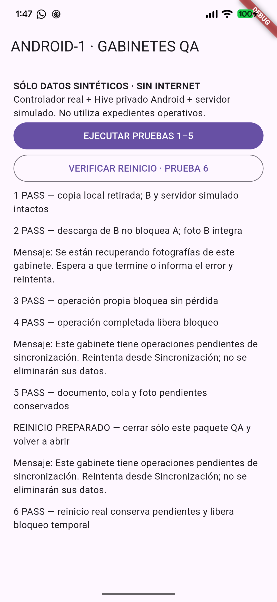

# ANDROID-1 — Certificación física de eliminación local

**Dictamen: PASS para los seis escenarios solicitados en una variante QA aislada del Pixel.**

Pruebas físicas instrumentadas con controlador y Hive reales en Android, servidor simulado y datos sintéticos. No equivalen a certificación contra API real ni a un recorrido manual completo de la pantalla operacional. No se modificó producción.

## 1. Estado Git y respaldos

Repositorio: `/Users/martino/DEV/ddr001_levantamientos`.
Origin: `https://github.com/MartinDavidOsuna/ddr001_levantamientos.git`.
Rama inicial/final: `feat/hydrostatic-mobile-sync`.
HEAD inicial: `9a903488a0d63ef50149b6d2ff1ca0b9eabb287e`.

Se revisaron los cambios HAPI-3.1 y el fix de Gabinetes. Antes del respaldo se ejecutaron análisis estático y suite móvil: 741 PASS, 0 FAIL, 1 omitida. Sólo entonces se crearon los commits locales separados:

```text
0ae3ab0c9791584a766a80d241c4f3c9621af2ef fix(cabinets): isolate local deletion locks and preserve pending work
e6e8d44f683da71de736c5a15700d2c6fdb6f992 feat(hydrostatic): preserve durable TEST document synchronization
```

El primer commit incluye 17 archivos de sincronización TEST, pruebas y documentación técnica reproducible; el segundo, únicamente el controlador de Gabinetes y sus pruebas (3 archivos). No se incluyeron informes, Excel, APK, fotos, logs ni archivos privados. No hubo push, merge ni worktrees nuevos.

Verificación SHA-256 adicional: los 18 archivos preexistentes inventariados antes del fix conservan exactamente su contenido. Los commits respaldan ese contenido sin descartarlo. El Excel y los informes existentes permanecen fuera del staging.

## 2. Inventario Android y seguridad

Dispositivo autorizado por ADB: **Pixel 7 Pro**, plataforma `cheetah_beta`, Android **17**, estado `device`. Un solo dispositivo conectado; comandos dirigidos explícitamente a su serial, omitido en este informe. Espacio libre inicial aproximado: 28 GB en /data.

| Variante | Package | Versión/code | UID Android | Resultado |
|---|---|---|---|---|
| Operativa | com.aquafim.ddr001levantamientos | 1.5.24 / 35 | 10376 | Intacta |
| QA hidrostática previa | com.aquafim.ddr001levantamientos.hydrotest | 1.5.18 / 29 | 10393 | Intacta |
| Nueva QA Gabinetes | com.aquafim.ddr001levantamientos.cabinettest | 1.5.24-qa.android1 / 36 | 10398 | Instalación nueva |

También se detectaron paquetes de diagnóstico; no se abrieron ni modificaron.

No se inspeccionaron expedientes privados operativos, por lo que no se afirma que estén sincronizados o sin pendientes. Se protegieron mediante aislamiento: no se actualizó, desinstaló, detuvo, limpió ni cambió de sesión la app operativa ni la QA hidrostática.

Fechas lastUpdateTime verificadas antes y después, sin cambios:
- Operativa: `2026-10-28 16:12:15`.
- QA hidrostática previa: `2026-10-28 10:05:27`.

No hubo root, borrado global, pm clear, uninstall, cambios de permisos operativos ni reinicio del teléfono. El único force-stop apuntó al nuevo package `.cabinettest` para la prueba 6.

## 3. APK y aislamiento comprobado

Artefacto conservado:
`/Users/martino/DEV/ddr001_levantamientos/build/app/outputs/flutter-apk/app-cabinettest-1.5.24-qa.android1-36.apk`

SHA-256 APK: `a532f7a5b9927de898cb2dbe7188d0dcf2b818bd2a04317dd9d9005cc3ad7848`.

- Debug, TEST, versionCode 36.
- Nombre visible: DDR001 GABINETES QA.
- Package `.cabinettest`, inexistente antes de instalar; ninguna versión fue degradada.
- Firma verificada con apksigner, certificado Android Debug. SHA-256 del certificado: `294d1c1cf25490509b7e0c9643cd82d42c48faed4b449e4d1497b59a6e0ac731`.
- `aapt dump permissions`: sin INTERNET ni ACCESS_NETWORK_STATE.
- Manifest: sin sharedUserId, allowBackup=false, autoridades de providers con package QA propio.
- Directorio privado: `/data/user/0/com.aquafim.ddr001levantamientos.cabinettest`.
- HttpOverrides bloquea HttpClient; el backend del ejecutor es exclusivamente un fake en memoria.
- Guardas de arranque: debug + APP_ENV=test + CABINET_DELETION_QA=true + package exacto.
- HYDROSTATIC_SYNC_ENABLED=false. HAPI-3.1 está consolidada y respaldada en la misma rama, pero este ejecutor dedicado no arranca el flujo normal ni pretende certificar envío hidrostático remoto.

La configuración Gradle añade un opt-in `cabinetDeletionTest`; sólo altera la identidad debug cuando se solicita explícitamente. Rechaza release y selección simultánea con la QA hidrostática. Los valores del build normal quedan iguales. No se solicitó ni usó firma productiva.

## 4. Compilación e instalación

Configuración reproducible en `docs/cabinets/android-local-deletion-qa.md`.

```sh
ORG_GRADLE_PROJECT_cabinetDeletionTest=true flutter build apk --debug --no-pub \
  -t test/cabinets/android_deletion_qa.dart \
  --build-name=1.5.24-qa.android1 --build-number=36 \
  --dart-define-from-file=/tmp/android1-build-defines.json
```

El archivo temporal de defines contiene sólo entorno TEST, banderas y catálogo fixture, sin credenciales. No se actualizó ningún paquete de Flutter.

Tras verificar APK, firma, manifiesto y ausencia del package en el Pixel:

```sh
adb -s <PIXEL> install -r build/app/outputs/flutter-apk/app-debug.apk
```

Resultado: **Success**. Es instalación nueva de `.cabinettest`; no reemplaza una variante existente. No se forzaron firmas ni downgrades.

Inicio:

```sh
adb -s <PIXEL> shell am start -n com.aquafim.ddr001levantamientos.cabinettest/com.aquafim.ddr001levantamientos.MainActivity
```

## 5. Ejecutor y datos sintéticos

Entry point: `test/cabinets/android_deletion_qa.dart`.
Reutiliza `test/cabinets/harness.dart`, el controlador real, CabinetStore y las cajas reales Hive dentro del sandbox QA. El harness admite una ubicación durable explícita para esta prueba; sus unit tests siguen usando directorios temporales. No se ejecuta su limpieza al finalizar el recorrido Android.

Fixtures con números sintéticos 99991 (A), 99992 (B), 99993 (pendiente) y 99994 (sonda de reinicio), todos convertidos a UID válido mediante el validador real `cabinetUid`. No se consultó un servidor para esos números ni se los trató como equipos productivos.

A se genera como copia confirmada por el backend fake, sin operaciones pendientes; B tiene un archivo sintético independiente. Para cada escenario destructivo se crea una nueva identidad UUID de A. Las pruebas verifican que el fake conserva el registro remoto. La actividad de descarga se controla con Completer para mantenerla inequívocamente en curso durante el intento de eliminación.

Las imágenes son PNG sintéticos mínimos (68 bytes), no fotografías de campo ni capturas de cámara. Su finalidad es comprobar conservación de bytes/relaciones, no calidad fotográfica.

## 6. Matriz física

| Caso | Entorno/acción | Resultado | Evidencia |
|---|---|---|---|
| 1. Sin actividad | Pixel, eliminar A confirmado | PASS | A ausente localmente; B idéntico; fake remoto intacto |
| 2. Actividad de B | Pixel, descarga de B suspendida; eliminar A | PASS | A retirado antes de completar B; documento y hash de B conservados |
| 3. Actividad propia | Pixel, descarga de A suspendida | PASS | Mensaje específico; documento A idéntico |
| 4. Operación terminada | Pixel, completar descarga de A y reintentar | PASS | Eliminación permitida, A ausente |
| 5. Pendientes | Pixel, registro sin enviar con foto | PASS | Rechazo; documento, operación y bytes intactos |
| 6. Reinicio | Force-stop sólo QA y reapertura; Hive real | PASS | Pendientes y B iguales; lock transitorio perdido; copia limpia eliminable |

Los casos 1–5 se dispararon pulsando mediante ADB el botón del ejecutor visible. Se guardó un checkpoint durable y se dejó una descarga activa de la sonda antes de detener el proceso. El PID cambió de 24385 a 24627. En el nuevo proceso se pulsó VERIFICAR REINICIO; la prueba leyó Hive y archivos desde disco, no estado de un widget anterior.

Mensajes observados:
- «Se están recuperando fotografías de este gabinete. Espera a que termine o informa el error y reintenta.»
- «Este gabinete tiene operaciones pendientes de sincronización. Reintenta desde Sincronización; no se eliminarán sus datos.»

No se volvió a producir el bloqueo global de otros expedientes.

## 7. Evidencia y logs

Resultado durable leído mediante `adb exec-out run-as` **exclusivamente del package QA**: seis casos PASS, error=null, synthetic=true, network=disabled.

```text
1 PASS — copia local retirada; B y servidor simulado intactos
2 PASS — descarga de B no bloquea A; foto B íntegra
Mensaje: Se están recuperando fotografías de este gabinete. Espera a que termine o informa el error y reintenta.
3 PASS — operación propia bloquea sin pérdida
4 PASS — operación completada libera bloqueo
Mensaje: Este gabinete tiene operaciones pendientes de sincronización. Reintenta desde Sincronización; no se eliminarán sus datos.
5 PASS — documento, cola y foto pendientes conservados
REINICIO PREPARADO — cerrar sólo este paquete QA y volver a abrir
Mensaje: Este gabinete tiene operaciones pendientes de sincronización. Reintenta desde Sincronización; no se eliminarán sus datos.
6 PASS — reinicio real conserva pendientes y libera bloqueo temporal
```

Captura del ejecutor QA después del reinicio:



Lectura independiente por ADB de los dos archivos sintéticos y cálculo SHA-256 en el Mac, comparados con el checkpoint anterior al reinicio:

| Archivo | Bytes | SHA-256 | Comparación |
|---|---:|---|---|
| B | 68 | fb504796dfd4e004d40220c159e744aa03df34b3d8f93e22a48561136b464198 | Idéntico |
| Pendiente | 68 | fb504796dfd4e004d40220c159e744aa03df34b3d8f93e22a48561136b464198 | Idéntico |

El hash igual entre ambos archivos es intencional: contienen la misma imagen fixture en archivos distintos; no es deduplicación de expedientes.

Logs sanitizados temporales: `/tmp/android1-first-five-log.txt`, `/tmp/android1-restart-log.txt`, `/tmp/android1-physical-results.json`, `/tmp/android1-photo-hashes.json`. No se exportaron fotos, tokens, sesiones ni coordenadas operativas.

## 8. Regresión

Antes de commits y al finalizar las adaptaciones QA:
- `flutter analyze --no-pub`: **sin incidencias**.
- `flutter test --no-pub --reporter expanded`: **741 PASS, 0 FAIL, 1 omitida**, ambas ejecuciones completas.
- Incluye pruebas de eliminación, Gabinetes, sincronización hidrostática, cámaras, almacenamiento y resto de regresión móvil.
- Omitida: integración que requiere `CABINETS_TEST_SESSION` y verificación previa de identidad TEST. No se usaron credenciales.
- `dart format` en archivos Dart QA: correcto.
- `git diff --check`: correcto.

No se cambiaron expectativas para obtener PASS. Los cambios posteriores a los commits sólo preparan la certificación: Gradle, harness, entrypoint QA y guía reproducible.

## 9. Incidencias y correcciones de preparación

1. El primer entrypoint se ubicó bajo lib e intentaba importar el harness fuera del paquete; analyze detectó la ruta inválida. Se trasladó a `test/cabinets/android_deletion_qa.dart` y se añadió el import explícito de sha256File. Una compilación iniciada con la ruta antigua falló; el build final y analyze posteriores pasaron.
2. apksigner no encontraba Java en PATH. Se utilizó temporalmente el JBR instalado de Android Studio mediante JAVA_HOME, sin cambiar configuración global.
3. Build emitió advertencia existente de Kotlin Gradle Plugin de flutter_image_compress_common. No se actualizaron dependencias.
4. Android debug informó que no podía abrir el servidor HTTP de Dart VM Service: comportamiento esperado al retirar INTERNET. Las pruebas se ejecutaron por ADB, botones y logs; no se habilitó red para depurar.
5. No se encontraron defectos nuevos en la eliminación durante esta campaña; no fueron necesarias modificaciones adicionales al controlador respaldado.

## 10. Estado final y límites

HEAD final: `0ae3ab0` (commit completo arriba). Main y origin intactos, sin pushes ni merges. Cambios de certificación pendientes de revisión, sin nuevo commit automático:
- `android/app/build.gradle.kts`.
- `test/cabinets/harness.dart`.
- `test/cabinets/android_deletion_qa.dart` (nuevo).
- `docs/cabinets/android-local-deletion-qa.md` (nuevo).
- Informe y captura QA, excluidos de commits.

**Datos existentes preservados** mediante aislamiento. La instalación operativa no recibió esta corrección ni fue manipulada; sigue requiriendo un proceso de distribución autorizado. No se certificó su contenido interno ni se afirmó ausencia de pendientes.

Alcance certificado: eliminación local y locks del controlador real en Android físico, integridad de fixtures y reapertura de almacenamiento. Pendiente fuera de esta campaña: navegación completa en la interfaz operativa y comunicación con API TEST real; no se necesitan para simular determinísticamente estos seis casos y no se presentan como PASS.

El paquete QA y sus datos sintéticos quedan instalados para revisión, sin limpieza. No repetir el lote sobre el checkpoint completado; la guía explica su protección. La APK no se publicó ni distribuyó externamente.

**ANDROID-1: PASS — 6 PASS físicos / 0 FAIL / 0 pendientes dentro de los seis casos instrumentados.**

## Apertura en VS Code
Informe verificado. Abierto mediante `code -r`, exit code 0.
