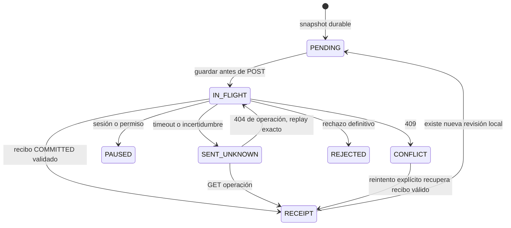

# HAPI-3.1 — Consolidación y sincronización móvil hidrostática

**Estado: COMPLETADA para consolidación e implementación/pruebas locales. Certificación remota TEST: PENDIENTE / NOT RUN.**
No se presenta validación en memoria como certificación SQL, HTTP desplegado o Pixel.

## 1. Git inicial y fuentes verificadas

Móvil principal `/Users/martino/DEV/ddr001_levantamientos`, origin oficial
`https://github.com/MartinDavidOsuna/ddr001_levantamientos.git`.
Rama inicial `feature/map-coordinates-1.4.1`, HEAD `0b78ac7decb368dd695ee31e537a635e4d025c3b`.
Main y origin/main, verificados mediante fetch no destructivo:
`a2882944539df0b56e169bc0b70bd7b12e5b9ab3`.

Histórico `/Users/martino/DEV/ddr001_levantamientos-hydrostatic`, rama
`feat/hydrostatic-tests-local`, HEAD inicial `6d6e5e2aef5ad77de82910ff359d7ee77021c3be`.
Se consultaron inventarios e informes HAPI-3 y M7.1 y la implementación real.
No se asumió que las referencias de conversaciones anteriores seguían vigentes.

API `/Users/martino/DEV/ddr001_api`, origin oficial
`https://github.com/MartinDavidOsuna/ddr001_api.git`, rama `feat/hydrostatic-api-integration`.
HEAD inicial y final `1181a7070b0937900704b70480e6bd5db10c59a5`.
Main/origin/main API siguen `3d7578847ab775831000656ee2f2b2da39d2bd1e` tras fetch.
No se editaron archivos API, SQL, Dashboard, NAS ni configuración de despliegue.

El principal tenía cinco archivos tracked modificados, cuatro componentes/tests
nuevos de mapas/galerías, un Excel e informes sin seguimiento. El histórico tenía
M7.1 y cuatro archivos de gabinetes, además de informes. No se incluyeron Excel,
informes, fotos, APK, logs, claves ni credenciales en los commits.

## 2. Recuperación y commits locales

Se revisaron los diffs y separaron por alcance. Se utilizaron blobs de índice
selectivos para los dos archivos compartidos de coordenadas/galería; sus archivos
de trabajo no se reescribieron para facilitar el staging. Se compararon SHA-256
antes/después: todos los archivos pendientes respaldados conservaron exactamente
sus bytes. En el histórico la comparación volvió a pasar al finalizar HAPI-3.1.

| Commit | Alcance | Rama de respaldo |
|---|---|---|
| `5ae3cb4912ca593311b0db3ebbff30622ffd8135` | Coordenadas/mapas, dependencias y pruebas | `feature/map-coordinates-1.4.1` |
| `344c5781937206ea5adb9745bb3d1bb21599fa41` | Galería/navegación y pruebas | `feature/map-coordinates-1.4.1` |
| `668eddd5b19fb22ea086289824a617d440616d95` | Recuperación M7.1 | `feat/hydrostatic-tests-local` |
| `a88f9ed964c79c6e09d451b016764fc41a7bfca6` | Recuperación correcciones de gabinetes | `feat/hydrostatic-tests-local` |
| `9a903488a0d63ef50149b6d2ff1ca0b9eabb287e` | Consolidación controlada | `feat/hydrostatic-mobile-sync` |

Coordenadas: `SurveyCoordinatesCard`, navegación externa a Google Maps, permiso
visual existente para residentes/admin, integración en detalles, dependencia
url_launcher y pruebas. Se preservó el cambio histórico de versión 1.4.4+10 en
ese respaldo. Galería: `SurveyPhotoGallery`, paginación finita, zoom, navegación,
evidencia local/remota y pruebas. Los fragmentos de `survey_detail_page.dart` y
`build_one_widgets_test.dart` se separaron antes de los commits.

M7.1: broker de cámara ante denegación explícita, cancelación de intención,
invalidation/cache de prevalidación, pruebas y documentación reproducible con
fixtures QR sintéticos. Gabinetes: modelo obligatorio, guardas de empresa,
orden/etiqueta de registro y previews estables; incluidas sus cuatro pruebas.
No se desarrollaron funciones nuevas en el worktree histórico.

## 3. Consolidación móvil

Se creó únicamente la rama convencional `feat/hydrostatic-mobile-sync` en el
checkout principal, a partir de la historia de coordenadas/galería respaldada.
Se hizo merge controlado, sin commit automático, de `feat/hydrostatic-tests-local`.
Su ascendencia contiene `origin/main` vigente y los once commits pendientes:
`f5cedb8`, `320c031`, `ec5ff7e`, `d2d3510`, `f5bd3cd`, `f30828c`, `b73cd5e`,
`5018d70`, `0a802d1`, `95487b1`, `de06c46`.
Los once fueron comprobados como ancestros del HEAD final y no de main.

Único conflicto textual: versión en `pubspec.yaml`, 1.4.4+10 frente a 1.5.18+29.
Se conservó 1.5.18+29 de la línea de gabinetes/hidrostáticas, sin generar ni publicar
una versión nueva. Esta versión de fuente no sustituye la numeración usada en la
APK productiva anterior 1.5.24+35; una futura distribución deberá asignar una versión
superior apropiada. No hubo compilación ni instalación APK en HAPI-3.1.

Coordenadas y galería ya estaban incorporadas en la línea histórica; el merge
conservó ambas y los ajustes posteriores de gabinetes/bases, incluida la lectura
no editable de waived. Se revisaron los diffs entre ambos padres. No se usaron
estrategias ours/theirs para descartar funciones. Análisis y 693 pruebas de la
consolidación pasaron antes de crear el commit de merge.

No se modificó main, no se crearon worktrees/clones, no se hicieron stash, reset,
clean, rebase, push ni merge a main. Los otros worktrees permanecieron fuera del
alcance de escritura. Sus estados finales fueron inventariados; conservan sus
cambios preexistentes. El Excel y todos los informes anteriores siguen presentes.

## 4. Arquitectura implementada y archivos

- `lib/core/hydrostatic/hydrostatic_bootstrap.dart`
- `lib/core/network/api_client.dart`
- `lib/data/hydrostatic/hydrostatic_repository.dart`
- `lib/data/hydrostatic/hydrostatic_store.dart`
- `lib/features/hydrostatic/hydrostatic_controller.dart`
- `lib/features/hydrostatic/hydrostatic_pages.dart`
- `lib/main.dart`
- `lib/core/hydrostatic/hydrostatic_sync_runner.dart`
- `lib/data/hydrostatic/hydrostatic_sync.dart`
- `lib/data/hydrostatic/hydrostatic_sync_api.dart`
- `lib/data/hydrostatic/hydrostatic_sync_store.dart`
- `test/hydrostatic/sync_test.dart`
- `test/hydrostatic/sync_api_test.dart`
- `test/hydrostatic/sync_contract_test.dart`
- `test/hydrostatic/sync_widgets_test.dart`
- `tool/hydrostatic/verify_hapi2_contract.ts`
- `docs/hydrostatic-sync-test.md`

`HydrostaticSyncStore`: caja exclusiva `hydrostatic_sync_v1`, esquema 1, checksum
SHA-256 por registro y escritor serial. Cada UUID tiene su cabeza aceptada,
comando activo, recibos y segmentos históricos congelados. Una escritura/flush
atómica del mismo registro guarda recibo y revisión; no hay transacción frágil
entre cajas para reconocer un ACK.

`HydrostaticSync`: coordinación de captura del checkpoint, causalidad, backoff,
recuperación y estado UI. Un único flight por instancia y un único comando activo
por expediente. Un expediente en conflicto no impide entregar los demás. Las
escrituras locales siguen su escritor existente y no esperan una respuesta HTTP.

`HydrostaticSyncApi`: adaptador HAPI-2 sobre ApiClient/Dio existente.
`HydrostaticSyncRunner`: reanudación, conectividad, eventos de documento y timer
mientras el proceso está vivo. Dependencias inyectables para pruebas.

Las únicas adaptaciones compartidas son: dos guardas opcionales de sesión e
instalación en ApiClient, composición de dependencias en main, y notificaciones
internas del store hidrostático. No se cambian AppController, cámara/broker,
LocationService, colas de bases/gabinetes, autenticación de login ni sus endpoints.

## 5. Contrato HTTP real utilizado

Código leído en API: `src/modules/hydrostatic/hydrostatic.routes.ts`,
`http.service.ts`, `http-contract.ts`, `schemas.ts`, `repository.ts`,
`validation.ts`, `domain.ts` y `json.ts`.

| Acción | Contrato |
|---|---|
| Verificar disponibilidad | GET /construction/hydrostatic-tests/capabilities |
| Registro | POST /construction/hydrostatic-tests/:testId/commands, REGISTER_DOCUMENT |
| Revisiones y declaración de video | Misma ruta, UPDATE_DOCUMENT |
| Recuperar recibo | GET /construction/hydrostatic-tests/:testId/operations/:operationId |
| Diagnóstico de conflicto | GET /construction/hydrostatic-tests/:testId/sync-status?sourceRevision=N |

El prefijo /api/v1 lo aporta la configuración existente. No se inventaron rutas.
DECLARE_VIDEO existe en API, pero UPDATE_DOCUMENT admite el checkpoint de video y
fue comprobado en el repositorio real. La declaración local conserva su operación
y timestamp originales; nunca se envía video ni se invoca WhatsApp.

Envelope estricto: contractVersion `hydrostatic-sync-v1`, operationId UUID v4,
expectedVersion, type, originInstallationId, payloadJson, payloadSha256 y
clientCreatedAt. Idempotency-Key coincide con operationId; If-Match usa
`"hydrostatic-<expectedVersion>"`. El payload contiene documento fuente íntegro,
baseSourceRevision/hash, historyManifest y captureIntents. Se limita a 8 MiB.
No se normalizan retrospectivamente snapshots ni se reasignan identidades.

## 6. Outbox durable, idempotencia y recuperación



RECEIPT representa la cabeza aceptada y active=null en el sidecar, no un resultado
hidráulico. Se conserva el source syncState=LOCAL_ONLY exigido por HAPI-2 y se
muestra entrega por separado. No existe isSynced ni se afirma fullyReconciled.

El snapshot se obtiene bajo el escritor del documento, sin journal local pendiente.
Antes del outbox se escribe `syncProtected:<UUID>` en metadatos hidrostáticos,
impidiendo la carrera con eliminación local. Si se interrumpe antes del outbox,
permanece el pin preventivo y el siguiente escaneo reconstruye sólo la operación
que aún no estaba congelada. Una vez congelada, nunca cambian UUID, timestamp,
versión o bytes del comando, incluso después de reiniciar Hive.

Tras ACK se valida contrato, UUIDs, hash de payload, revisión, fingerprint de
request y versión remota esperada antes de actualizar la cabeza. Una falla después
del ACK durable no resucita la operación. Si cambió el documento durante el envío,
se construye después un UPDATE_DOCUMENT con la cabeza aceptada como base.
El drain es acotado para no monopolizar otros expedientes.

Backoff exponencial con jitter y retryAt durable. Un error de red no elimina nada.
Un recibo inválido deja incertidumbre y exige recuperación. Ante outbox corrupto
se conserva la fuente, no se reconstruye un envío a ciegas y los otros expedientes
pueden continuar. Un error al abrir el outbox permite seguir usando la captura
local y ofrece reintento; no se borra ni se recrea almacenamiento.

## 7. Identidad, sesiones y conflictos

Autoría histórica userId/sessionId/deviceInstallationId permanece intacta.
El coordinador sólo selecciona documentos del actor e instalación autorizados.
Antes y después de await verifica la identidad de la sesión. ApiClient comprueba
además expectedActor, expectedSessionId y expectedInstallationId antes de enviar,
incluido el replay tras refresh. No se persisten tokens en documentos/outbox.

Un login distinto pausa y oculta la entrega del actor anterior. Un nuevo login del
mismo actor/instalación puede recuperar su recibo, sujeto a la validación de sesión
histórica del backend. No se envía bajo otra instalación ni se transfiere ownership.

409 conserva el comando, fuente y sync-status remoto como diagnóstico. El botón
manual busca recibo y repite únicamente el mismo comando; nunca cambia a la versión
remota ni aplica última escritura gana. Si existe divergencia real, permanece para
revisión: HAPI-2 no tiene una operación administrativa de reconciliación autorizada.
Este límite es explícito, no se simula resolución sobrescribiendo información.

## 8. Automatización y UI

Activación únicamente con APP_ENV=test y HYDROSTATIC_SYNC_ENABLED=true, host no
productivo, ApiClient real y capabilities TEST compatibles. Default false.
La app productiva y el entrypoint QA sin INTERNET no habilitan esta sincronización.

Disparadores: inicio autorizado, escritura durable, recuperación de conectividad,
resumed y revisión periódica cada 30 segundos en proceso. No se promete ejecución
permanente al cerrar la app. Al volver, se reconstruye desde fuente y outbox.
Sin trabajo pendiente no se solicitan capacidades repetidamente.

Lista, preparaciones, historial y detalle muestran estados de entrega independientes.
Hay reintento manual en lista/detalle, último recibo y explicación de conflicto.
APROBADO/FUGA/DESCARTADA continúan siendo resultados locales del procedimiento.
El ACK se presenta como «Documento recibido · fotos e historial pendientes de
transferencia», nunca como validación de evidencias por servidor.

## 9. Historial, fotografías y eliminación

No se transfieren bytes fotográficos. Se envía metadata existente tal como exige
el contrato, manteniendo hashes, roles, origen temporal, GPS y asociaciones. No
se alteraron archivos reales ni galerías/broker durante la nueva sincronización.
Los tests comprobaron hashes de fixtures después de ACK/reintento y recuperación.
Un archivo faltante/corrupto no queda reparado ni verificado por recibir el documento.

Los segmentos del journal APPLIED se congelan en el sidecar con hash/manifiesto;
se conservan íntegros localmente para una etapa posterior. HAPI-2 no recibe los
bytes de los segmentos, por eso el historial transferido tampoco se da por confirmado.
Las intenciones sin cambio de revisión fuente esperan el siguiente checkpoint,
sin fabricar revisiones incompatibles. No se borran borradores ni capturas ambiguas.

La eliminación temporal conserva autorización/build sintético/confirmación y
bloqueo de prueba activa; además el repositorio y UI rechazan expedientes con pin
de sincronización, antes y después del recibo. No hay borrado global, purga por
logout, limpieza de colas ni endpoints DELETE nuevos.

## 10. Pruebas y evidencia

| Validación | Resultado |
|---|---|
| Principal antes de respaldo | analyze PASS; 170 PASS, 0 FAIL |
| Histórico antes de respaldo | analyze PASS; 693 PASS, 0 FAIL, 1 omitida |
| Consolidación antes del commit | analyze PASS; 693 PASS, 0 FAIL, 1 omitida |
| Suite hidrostática final | 462 PASS, 0 FAIL |
| Regresión móvil general | 731 PASS, 0 FAIL, 1 omitida |
| Verificación UI final tras indicadores de lista | 22 PASS, 0 FAIL |
| Análisis estático final | No issues found |
| git diff --check | PASS |
| Código real HAPI-2 con checkpoints Flutter | 15 checkpoints + 15 replays PASS, 4 expedientes sintéticos |
| HTTP/SQL TEST remoto desde móvil | NOT RUN |
| Pixel físico / fotografías de campo | NOT RUN; no se conectó ni se enviaron datos |

No sumar ejecuciones repetidas como pruebas distintas. Los 38 casos nuevos se
incluyen en la suite general (26 outbox, 7 transporte, 2 contrato/gate, 3 widgets).
La omisión general corresponde al opt-in de integración remota de gabinetes;
no se configuró una sesión real para esa prueba. No se actualizó ninguna dependencia.
No se midió cobertura en esta ejecución.

Se cubren: reinicio durante envío; pérdida de respuesta tras COMMIT; replay exacto;
falla antes/después de enqueue/sending/acknowledge; reopening Hive real temporal;
concurrencia de drains y cambios locales durante POST; sesión e instalación cambiadas;
refresh 401 sin cambiar envelope; 403/422/409; backoff/conectividad; expediente en
conflicto junto a otro entregado; recibo inválido; checksum corrupto; pin de borrado;
APROBADO con video independiente; FUGA; descarte; anomalía temporal; originales
sintéticos preservados; error de apertura de outbox sin bloquear operación local;
disparadores de inicio, escritura, conectividad y resume; UI/reintento.
La suite general incluye cámaras, galerías, GPS, auth, QR, bases, gabinetes,
almacenamiento, journals y navegación. No se alteraron expectativas de pruebas
preexistentes para obtener PASS.

La verificación cruzada ejecutó schemas, validadores y HydrostaticRepository reales
del commit API indicado con una transacción en memoria. Confirmó secuencia,
inmutabilidad, fingerprints, hashes y recibos idempotentes de los 15 checkpoints
producidos por Flutter. No equivale a transacciones SQL2014 ni middleware HTTP real.
Script reproducible: `tool/hydrostatic/verify_hapi2_contract.ts`; instrucciones en
`docs/hydrostatic-sync-test.md`.

Logs locales: `/tmp/h31-original-analyze.log`, `/tmp/h31-original-test.log`,
`/tmp/h31-historical-analyze.log`, `/tmp/h31-historical-test.log`,
`/tmp/h31-consolidation-analyze.log`, `/tmp/h31-consolidation-tests.log`,
`/tmp/h31-hydro-final.log`, `/tmp/h31-final-tests2.log`,
`/tmp/h31-final-analyze5.log`, `/tmp/h31-final-ui.log`,
`/tmp/h31-contract-repro.log`. No contienen tokens/sesiones reales.

## 11. Incidencias y correcciones

1. Conflicto de versión en pubspec resuelto según la línea de gabinetes, conservando
   las dependencias de mapas y toda la historia en ambos padres.
2. El análisis intermedio reportó llaves de control y un import de test no utilizado.
   Se corrigieron exclusivamente los archivos nuevos del alcance. Final sin issues.
3. Primera regresión general: 729 PASS, 1 FAIL, 1 omitida. La prueba nueva de 409
   suponía que Hive enumeraba expedientes según inserción. El fallo comparó el
   comando de un expediente distinto. Se corrigió el fixture para fallar por UUID,
   verificar cada replay por operationId y asegurar que el otro expediente confirma
   en el mismo ciclo. No se relajó la expectativa de idempotencia ni se cambió
   comportamiento productivo para satisfacer el test. Regresión final 731 PASS.
4. Se aisló la apertura del outbox de la apertura del repositorio: un fallo de
   almacenamiento del sidecar no bloquea indebidamente la captura local. Incluye test.

## 12. Integración TEST y límites

Se verificó únicamente por allowlist que la configuración local API identifica
NODE_ENV=test y SQL_DATABASE=DDR001_Hidrantes_TEST. No se imprimieron credenciales.
Una comprobación de conexión TCP a localhost en el puerto configurado no encontró
listener. El informe HAPI-2 también aclara que su servidor HTTP fue efímero y no
quedó un servicio persistente. No se arrancó un servicio ni se usaron sesiones SQL
para simular una certificación móvil.

Pendiente: levantar/verificar una API TEST accesible, disponer de sesión Field y
gabinete sintéticos verificables, ejecutar el cliente móvil contra ella, comprobar
recibos y revisiones en SQL y recuperación real en instalación TEST autorizada.
No se utilizó el Pixel ni se enviaron sus registros. No se accedió a producción.

## 13. Riesgos residuales y próximos pasos

- Transferencia física, verificación SHA servidor, segmentos históricos y NAS son
  etapas posteriores; no usar el ACK documental como certificación integral.
- Conflictos verdaderos permanecen preservados y requieren un procedimiento de
  revisión compatible con API; no hay una resolución administrativa inventada.
- Los snapshots y recibos se retienen sin purga. Su crecimiento puede consumir
  espacio; definir retención sólo cuando exista reconciliación/backup verificable.
  Payloads mayores de 8 MiB permanecen locales con error; no se truncan.
- Gates TEST y bandera están deshabilitados por defecto. Una futura integración
  productiva requiere contrato/despliegue coordinados y nueva autorización.
- La certificación remota y física queda pendiente, pero no impide revisar la
  implementación local completa solicitada por HAPI-3.1.

## 14. Git final y entrega

Rama `feat/hydrostatic-mobile-sync`; HEAD de consolidación:
`9a903488a0d63ef50149b6d2ff1ca0b9eabb287e`.
El desarrollo nuevo HAPI-3.1 está SIN COMMIT para revisión. Sólo se crearon los
cinco commits autorizados de respaldo/consolidación. Ningún push ni despliegue.
Main móvil/API y referencias remotas se conservaron como se detalla arriba.

Estado antes de escribir este informe:
```text
M lib/core/hydrostatic/hydrostatic_bootstrap.dart
 M lib/core/network/api_client.dart
 M lib/data/hydrostatic/hydrostatic_repository.dart
 M lib/data/hydrostatic/hydrostatic_store.dart
 M lib/features/hydrostatic/hydrostatic_controller.dart
 M lib/features/hydrostatic/hydrostatic_pages.dart
 M lib/main.dart
?? "A3-A2-A1-A4 - HIDRANTES PARCELARIOS - Material para codigos QR(1).xlsx"
?? docs/hydrostatic-sync-test.md
?? lib/core/hydrostatic/hydrostatic_sync_runner.dart
?? lib/data/hydrostatic/hydrostatic_sync.dart
?? lib/data/hydrostatic/hydrostatic_sync_api.dart
?? lib/data/hydrostatic/hydrostatic_sync_store.dart
?? "resultados codex/"
?? test/hydrostatic/sync_api_test.dart
?? test/hydrostatic/sync_contract_test.dart
?? test/hydrostatic/sync_test.dart
?? test/hydrostatic/sync_widgets_test.dart
?? tool/hydrostatic/verify_hapi2_contract.ts
```

## 15. Informe y VS Code

/Users/martino/DEV/ddr001_levantamientos/resultados codex/HAPI-3.1_2026-10-29_10-26-11.md

El archivo se creó sin sobrescribir informes anteriores. La apertura y existencia
se verificarán al terminar; resultado se registra debajo.

**HAPI-3.1: COMPLETADA (implementación y certificación local). Integración remota TEST pendiente.**

VS Code: abierto; CLI code -r terminó con código 0.
Existencia y contenido del Markdown verificados.
