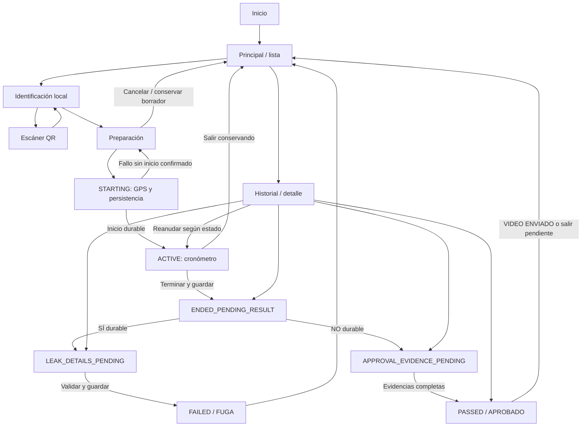

# M1 — Diseño de Pruebas Hidrostáticas

Fecha: 27 de octubre de 2026, America/Hermosillo. Alcance: especificación; no implementación.

**El módulo se diseñará como un dominio local independiente, con Provider, Navigator y Hive. No utilizará las colas ni los comandos de sincronización de bases o gabinetes.**

Convenciones del informe:

- **HECHO VERIFICADO EN CÓDIGO:** observado en archivos o Git durante esta auditoría.
- **DECISIÓN DE DISEÑO:** contrato propuesto para implementar en M2–M7; todavía no existe.
- **PROPUESTA PENDIENTE:** requiere aceptación funcional o técnica antes de activarse.
- **RIESGO:** límite o situación que exige tratamiento explícito.
- **BLOQUEO:** condición que impide una implementación o habilitación concreta, no necesariamente concluir el diseño.

## 1. Estado Git actualizado y base recomendada

**HECHO VERIFICADO EN CÓDIGO.** Remoto: `https://github.com/MartinDavidOsuna/ddr001_levantamientos.git`. Se ejecutaron `git fetch origin main` y `git ls-remote origin refs/heads/main`; ambos confirmaron:

`origin/main = a2882944539df0b56e169bc0b70bd7b12e5b9ab3`

Inventario de todos los worktrees registrados; rutas relativas a `/Users/martino/DEV/`:

| Worktree | Rama | HEAD abreviado | Estado inicial |
|---|---|---|---|
| `ddr001_levantamientos` | `feature/map-coordinates-1.4.1` | `0b78ac7` | 5 modificados, 5 sin seguimiento |
| `ddr001_levantamientos-cabinets` | `feat/ddr001-cabinets-mobile` | `22bc3c4` | Limpio |
| `ddr001_levantamientos-certification` | `release/levantamientos-production-branding` | `5525592` | Limpio |
| `ddr001_levantamientos-company-shared` | `feature/company-shared-surveys` | `8917fab` | Limpio |
| `ddr001_levantamientos-display-names` | `feat/cabinet-checklist-display-names` | `f5cedb8` | 18 modificados, 5 sin seguimiento |
| `ddr001_levantamientos-evidence-sync` | `fix/cabinet-evidence-sync-audit` | `de06c46` | Limpio |
| `ddr001_levantamientos-release-1.3.0+4` | HEAD separado | `3f3a844` | Limpio |
| `ddr001_levantamientos-test-crew-refresh` | `main` | `a288294` | 7 modificados, 2 sin seguimiento |

HEAD completo del checkout principal: `0b78ac7decb368dd695ee31e537a635e4d025c3b`.

HEAD completo de la rama limpia de correcciones: `de06c46d5473f64d30176ffb7bd194109b66c6a9`.

El checkout principal está seis commits detrás de main, además de su trabajo sin confirmar. La rama de correcciones está 11 commits por delante de main, sin commits exclusivos de main. El worktree llamado main está modificado: su contenido de disco no representa exactamente `origin/main`. Las comparaciones se hicieron contra el objeto Git confirmado.

Commits relevantes verificados:

| Commit | Contenido | En main |
|---|---|---|
| `4a0b4a0` | Gabinetes offline y sincronización causal | Sí |
| `22bc3c4` | Prevención de errores de campo | Sí |
| `a288294` | Flujo autorizado de producción, 1.5.2+13 | Sí |
| `ec5ff7e` | Evidencias compartidas y estado durable de sincronización | No |
| `f5bd3cd`, `f30828c` | Empresa y reconciliación explícita | No |
| `b73cd5e`, `5018d70` | Lista de disponibles y ajustes de identificación | No |
| `0a802d1`, `95487b1`, `de06c46` | Eliminación local y recuperación de ausencia remota | No |

Los otros commits adicionales son `f5cedb8`, `320c031` y `d2d3510`: catálogo/nombres, preservación de cambios de campo y pruebas HTTP, respectivamente.

**PROPUESTA PENDIENTE — base de M2.** Recomiendo un worktree nuevo y aislado, creado posteriormente desde `de06c46`, si se acepta expresamente esa dependencia de los 11 commits. Conserva las correcciones recientes y evita volver a introducir sus errores. Si se exige partir estrictamente de main, primero debe resolverse la revisión/integración de esas correcciones; no copiar fragmentos informalmente. No usar como base ninguno de los worktrees modificados ni hacer stash, reset, limpieza o cambio de rama sobre ellos.

**BLOQUEO para empezar M2:** confirmar esa base. M1 no integra ramas ni crea worktrees.

Versiones verificadas: main declara app `1.5.2+13`, la rama de correcciones `1.5.18+29`; ambos declaran Dart `^3.12.2`. CI fija Flutter `3.44.8 stable`. La versión de APK puede diferir por parámetros de compilación; no se debe deducir del pubspec qué está instalado en un teléfono. No se inspeccionó ni ejecutó el Pixel en M1.

## 2. Arquitectura y reutilización

**HECHO VERIFICADO EN CÓDIGO.** Se releyeron las clases siguientes en el checkout limpio y se contrastaron los cambios relevantes con main. Los enlaces apuntan a ese checkout; no implican que todas sus mejoras estén integradas.

| Capacidad | Implementación real | Uso previsto y límite |
|---|---|---|
| Inyección y arranque | [main.dart](/Users/martino/DEV/ddr001_levantamientos-evidence-sync/lib/main.dart), `MultiProvider` | Incorporar un controlador independiente; no ejecutar sincronización desde él |
| Estado/sesión | [AppController](/Users/martino/DEV/ddr001_levantamientos-evidence-sync/lib/core/services/app_controller.dart) | Observar sesión/perfil; no reutilizar su cola |
| Identidad durable | [FieldSession, SecureSessionStore](/Users/martino/DEV/ddr001_levantamientos-evidence-sync/lib/core/security/session_store.dart) | Leer identidad y sesión; no copiar tokens al módulo |
| QR/UID | [cabinetUid, displayUid](/Users/martino/DEV/ddr001_levantamientos-evidence-sync/lib/domain/cabinets/cabinet_models.dart) | Validación existente; no abrir URL |
| Gabinetes | [CabinetController](/Users/martino/DEV/ddr001_levantamientos-evidence-sync/lib/data/cabinets/cabinet_controller.dart), [CabinetStore](/Users/martino/DEV/ddr001_levantamientos-evidence-sync/lib/data/cabinets/cabinet_store.dart) | Lectura autorizada, snapshot; nunca `scan()` para consultar |
| GPS | [LocationService, LocationEvidencePolicy](/Users/martino/DEV/ddr001_levantamientos-evidence-sync/lib/core/location/location_service.dart) | Captura y validación mediante adaptador; servicio existente sin alterar |
| Cámara | [PhotoCaptureService, ConstructionImagePicker](/Users/martino/DEV/ddr001_levantamientos-evidence-sync/lib/core/media/photo_capture_service.dart) | Copia durable, miniatura y hash; requiere coordinación de recuperación |
| Journal | [ConstructionOperationJournal](/Users/martino/DEV/ddr001_levantamientos-evidence-sync/lib/core/persistence/construction_operation_journal.dart) | Patrón e interfaz reutilizables con cajas nuevas |
| Persistencia | [LocalStore](/Users/martino/DEV/ddr001_levantamientos-evidence-sync/lib/core/persistence/local_store.dart) | No invocar `LocalStore.open()` para hidrostáticas: abre y migra cajas de bases |
| UI | [LevantamientosApp](/Users/martino/DEV/ddr001_levantamientos-evidence-sync/lib/app/app.dart), [MainShell](/Users/martino/DEV/ddr001_levantamientos-evidence-sync/lib/features/shell/main_shell.dart) | Tema Material 3, Navigator, pestañas existentes |
| Entrada | [HomePage](/Users/martino/DEV/ddr001_levantamientos-evidence-sync/lib/features/home/home_page.dart) | Añadir posteriormente tarjeta sin sustituir otras |

Provider/ChangeNotifier y `Navigator`/`MaterialPageRoute` son los mecanismos reales. `go_router` está declarado pero no se encontró uso en `lib`; no se introducirá para este módulo.

**DECISIÓN DE DISEÑO.** Organización propuesta, todavía inexistente:

| Ubicación/clase | Responsabilidad | Dependencias permitidas |
|---|---|---|
| `domain/hydrostatic/HydrostaticTest` | Agregado, estados e invariantes | Tipos de dominio puros |
| `HydrostaticLeak`, `HydrostaticJoint` | Uniones, presión y catálogo versionado | Dominio |
| `HydrostaticEvidence` | Identidad, roles, integridad y metadatos de foto | Dominio |
| `data/hydrostatic/HydrostaticRepository` | Lectura, comandos durables y recuperación | Store propio, reloj, autorización |
| `HydrostaticStore` | JSON/Hive, índices reconstruibles y flush | Sólo cajas propias |
| `core/hydrostatic/HydrostaticClock` | UTC, tiempo monotónico y anomalías | Fuente temporal inyectable |
| `HydrostaticCabinetLookup` | Consulta local sin efectos de red | Vista autorizada de gabinetes |
| `HydrostaticPhotoCoordinator` | Intención, captura, recuperación, integridad | Motor fotográfico, broker de cámara y store propio |
| `HydrostaticLocationAdapter` | Aplicar política al fix obtenido | `LocationService` |
| `HydrostaticController` | Orquestación y estado visible | Contratos anteriores; no Dio/API |
| `features/hydrostatic/` | Pantallas y diálogos | Controlador, modelos inmutables |
| `test/hydrostatic/` | Dominio, repositorio, widgets y recuperación | Fakes y directorios temporales |

La UI no abrirá cajas ni escribirá archivos. El dominio no conocerá widgets, Hive ni HTTP. El controlador no modificará gabinetes. El nuevo módulo no tendrá scheduler de sincronización en su etapa local.

## 3. Acceso, pantallas y controles

**PROPUESTA PENDIENTE — permisos.** Política inicial: usuario de campo autenticado que satisfaga el acceso existente a gabinetes. Actualmente eso significa sesión `field`, perfil residente con el mismo `userId` y autorización local de gabinetes. No equivale a cualquier usuario de campo; no se amplía a contratista/admin/superadmin. Debe validarse antes de habilitar el módulo.

**DECISIÓN DE DISEÑO.** Tarjeta `PRUEBAS HIDROSTÁTICAS` en Inicio, después del último acceso de gabinetes, conservando los demás. Abre la pantalla principal/lista del módulo, no la cámara.

| Pantalla | Controles y contenido |
|---|---|
| Principal/lista | NUEVA PRUEBA; gabinete/UID/modelo; intentos; fecha, duración y estado; acceso a historial; sección separada PREPARACIONES GUARDADAS |
| Identificación | ESCANEAR QR; campo NS con ejemplo válido `AQ26-00001-7`; buscar local; volver |
| Escáner | Cámara QR, cancelar y error legible; bloqueo de detecciones repetidas |
| Preparación | PRUEBA HIDROSTÁTICA; UID, modelo, usuario; número provisional; foto inicial obligatoria y galería; INICIAR PRUEBA; CANCELAR |
| Inicio pendiente | Progreso GPS/guardado, acciones duplicadas bloqueadas; error con reintento; no cronómetro confirmado |
| Activa | UID, modelo, usuario, Prueba #N, inicio, HH:MM:SS; objetivo 5 bar; instrucción 1 → 2 → 3 → 4 → 5; captura 5 bar; instrucciones del video; TERMINAR PRUEBA |
| Resultado pendiente | Duración guardada; ¿SE REGISTRARON FUGAS? SÍ / NO; salir conservando pendiente |
| Registro de fugas | UID, #N, duración, presión general de primera fuga, uniones múltiples, presión por unión, Otro, fotos, GUARDAR RESULTADO |
| Resumen/aprobación | Datos completos, tiempos, ubicación, máxima 5 bar, final 4 bar, espacios de evidencia; GUARDAR APROBACIÓN; instrucciones y VIDEO ENVIADO |
| Historial/detalle | Intentos ordenados, estado, evidencia, metadatos y video; REANUDAR según estado; NUEVO INTENTO |
| Eliminación de desarrollo | ELIMINAR PRUEBA LOCAL; UID/#N; advertencia y confirmación explícita |

La lista incluye exclusivamente gabinetes con una prueba cuyo inicio esté confirmado durablemente. Las preparaciones no cuentan como intentos; se muestran en una sección aparte recuperable. La lista se agrupa por UID, muestra el último intento y despliega los anteriores. APROBADO verde; FUGA rojo; estados pendientes en advertencia, siempre con texto además de color. APROBADO añade VIDEO PENDIENTE o VIDEO ENVIADO.

Si no hay gabinete local: “Este gabinete no está disponible en este teléfono. Descárgalo desde Gabinetes y vuelve a intentar”. Permitir corregir NS o volver; no inventar modelo, crear gabinete, refrescar catálogo ni consultar API. Un QR sólo se normaliza y valida mediante `cabinetUid(raw.trim())`. `displayUid` se usa después de validar.

**PROPUESTA PENDIENTE — admisibilidad.** Permitir pruebas iniciales a gabinetes locales registrados, incompletos o validados, no borradores, archivados ni en eliminación. Un gabinete instalado requiere autorización funcional explícita para una eventual repetición en banco. Si cambia el modelo antes de iniciar, mostrar el cambio y exigir confirmar nuevamente la preparación; después del inicio conservar el snapshot histórico.

**DECISIÓN DE DISEÑO — secuencia física.** La foto de 5 bar y el video deben realizarse mientras realmente se mantienen 5 bar. Por eso la pantalla activa ofrece captura e instrucciones, sin introducir controles por escalón. TERMINAR registra el fin del intervalo cronometrado; después se registra la condición final a 4 bar. El resumen repite las instrucciones del video, pero no invita a subir nuevamente la presión sólo para completar un pendiente. Falta de evidencia histórica exige revisar/repetir el procedimiento, no atribuir una foto posterior a un momento pasado.

## 4. Diagrama de navegación

## 5. Matriz de navegación y comportamiento de Back

**DECISIÓN DE DISEÑO.** Back del AppBar y Back físico/gestual Android comparten el mismo manejador mediante `PopScope`. No depender de `dispose` para guardar. El controlador pertenece al módulo, no al widget de una pantalla. Las rutas llevan únicamente IDs; la página se reconstruye desde repositorio.

| Origen / acción | Destino | Validación y escritura local | Back / Cancelar | Recuperación |
|---|---|---|---|---|
| Inicio / entrar | Principal | Autorización; abrir sólo stores nuevos | Back a Inicio | Principal con pendientes |
| Principal / nueva | Identificación | Sesión válida; ninguna prueba creada | Back a Principal | Sin intento nuevo |
| Identificación / escanear | Escáner | Permiso cámara; no escritura de prueba | Cancelar vuelve a Identificación | Repetir identificación |
| Identificación / NS o QR | Preparación | UID válido, coincidencia local única y autorizada; crear/reutilizar preparación UUID | Back conserva preparación | Preparación guardada |
| Preparación / foto | Preparación | Intención durable antes de cámara; foto y vínculo propios | Cámara cancelada conserva preparación | Recuperar intención/foto |
| Preparación / cancelar | Principal | Sin foto: marcar preparación descartada; con foto: elegir conservar o descartar borrador con confirmación | Cerrar diálogo no descarta | Borrador conservado o eliminación recuperable |
| Preparación / iniciar | Inicio pendiente → Activa | Identidad, gabinete, foto durable, GPS; numeración e inicio con journal | Durante escritura no abandonar hasta resolver; Back no cancela un commit incierto | Reconciliar STARTING; nunca crear otro intento |
| Activa / Back | Diálogo → Principal o Activa | “Salir conservando” / “Continuar”; guardar checkpoint | Nunca termina ni borra | Reanudar ACTIVE |
| Activa / terminar | Resultado pendiente | End idempotente: fin y duración persistidos antes del diálogo | Back conserva fin | Pregunta pendiente, reloj detenido |
| Resultado / Sí | Fugas | Persistir respuesta y estado antes de navegar | Back a Principal conservando pendiente | Fugas con avance |
| Resultado / No | Resumen | Persistir respuesta y estado antes de navegar | Back a Principal | Evidencias pendientes |
| Fugas / editar o fotografiar | Fugas | Guardar cada cambio aceptado; intenciones durables | Back espera flush; error no finge guardado | Recuperar campos y fotos |
| Fugas / guardar | Detalle FUGA / lista | Validación completa, comando de cierre | Back a lista | FAILED |
| Resumen / capturar | Resumen | Rol fotográfico e integridad; no inventar captura pasada | Back conserva estado | APPROVAL_EVIDENCE_PENDING |
| Resumen / aprobar | Resumen APROBADO | Evidencias y duración válidas; cierre durable | Back a lista, video pendiente | PASSED + PENDING |
| APROBADO / VIDEO ENVIADO | Lista | Guardar actor y timestamp; sin WhatsApp/API | Back sin confirmar conserva pendiente | PASSED + DECLARED_SENT |
| Lista / intento | Detalle o pantalla pendiente | Leer estado durable y permiso | Back a lista | Mismo intento |
| Detalle / nuevo intento | Preparación | Otro UUID; no copiar resultado ni evidencia como cumplimiento | Cancelar antes de inicio | Borrador separado |
| Detalle / eliminar local | Lista | Sólo modo desarrollo, confirmación y journal de eliminación | Cancelar no escribe | Completar borrado ya confirmado |

Cambiar una respuesta Sí/No antes del cierre requiere confirmación y comando explícito. No borra capturas: conserva la rama anterior como borrador/historial, pero no la cuenta para el cierre incompatible. Después de FAILED/PASSED no se cambia el resultado; se crea un intento nuevo.

Eventos del sistema:

| Evento | Comportamiento |
|---|---|
| Home, otra app, bloqueo | No cancelar ni terminar; checkpoint oportunista; al volver recalcular tiempo |
| Cierre forzado/reinicio | Reabrir journals primero y documentos después; retomar el estado durable |
| Cambio de usuario/logout | Ocultar expedientes ajenos; suspender edición/cámara; mantener atribución y archivos |
| Revocación GPS antes de inicio | No iniciar; conservar preparación |
| Revocación GPS durante prueba | Conservar inicio; advertir para evidencias nuevas; no detener el tiempo automáticamente |
| Cámara cancelada | Registrar intención cancelada; no contar foto ni alterar ejecución |
| Error de almacenamiento | Bloquear transición y navegación que afirmaría guardado; mostrar reintento |
| Varios días inconclusa | Mostrar “Prueba abierta desde…”; no expirar, completar ni renumerar automáticamente |

El contador puede superar 24 horas: HH es acumulativo, no hora del día. No habrá ejecución permanente prometida en segundo plano.

## 6. Máquina de estados formal

**DECISIÓN DE DISEÑO.** `executionState` usa exactamente los ocho estados requeridos. STARTING no significa prueba iniciada. El resultado hidráulico es otro campo: `null`, `LEAK` o `PASS`.

| Estado | Evento | Precondiciones | Siguiente / efectos durables |
|---|---|---|---|
| PREPARATION | requestStart | Actor autorizado, gabinete admisible, foto inicial válida | STARTING con operationId estable |
| STARTING | gpsFailure | No existe compromiso de inicio listo para aplicar | PREPARATION, error preservado; sin número definitivo |
| STARTING | commitStart | GPS válido, mismo actor, foto íntegra, escritura posible | ACTIVE, número/start UTC/snapshot guardados |
| STARTING | storageUncertain | Escritura interrumpida | Mantener recuperación pendiente; consultar journal, no duplicar |
| ACTIVE | finish | Actor original; operación de fin única | ENDED_PENDING_RESULT con fin/duración/checkpoint |
| ENDED_PENDING_RESULT | answerLeak(true) | Fin durable | LEAK_DETAILS_PENDING; respuesta durable |
| ENDED_PENDING_RESULT | answerLeak(false) | Fin durable | APPROVAL_EVIDENCE_PENDING; respuesta durable |
| LEAK_DETAILS_PENDING | closeLeak | Uniones, presiones, Otro, foto inicial y ≥1 foto de fuga íntegras; tiempo resoluble | FAILED, resultado LEAK |
| APPROVAL_EVIDENCE_PENDING | closePass | Inicial, 5 bar, final 4 bar; metadatos requeridos; tiempo resoluble | PASSED, resultado PASS; video PENDING |
| LEAK_DETAILS_PENDING / APPROVAL_EVIDENCE_PENDING | reviseAnswer | Confirmación antes de cierre | Estado alternativo; conservar datos anteriores sin contarlos |
| PASSED | declareVideoSent | Actor permitido y resultado durable | PASSED; video DECLARED_SENT |
| FAILED / PASSED | newAttempt | Autorización y política de concurrencia | Otro agregado PREPARATION; original inmutable |

Invariantes:

1. `attemptNumber`, `startedAtUtc` e inicio confirmado existen juntos en ACTIVE o estados posteriores.
2. Un estado terminado conserva `endedAtUtc`; ninguna reanudación vuelve a ACTIVE.
3. FAILED corresponde a LEAK; PASSED a PASS. Estados intermedios no tienen resultado definitivo.
4. Pasar directamente PREPARATION → PASSED, ACTIVE → FAILED o FAILED → PASSED es inválido.
5. No cerrar sin evidencia durable, íntegra y correctamente atribuida.
6. Sin autorización no se permiten cambios, aunque se conozca el UUID.
7. La ausencia de red no cambia el estado hidráulico ni elimina pendientes.
8. La UI presenta la transición completada sólo después del acuse durable del repositorio.

Dimensiones separadas:

| Dimensión | Valores propuestos |
|---|---|
| Evidencia | EXPECTED, CAPTURING, PENDING_METADATA, READY, AMBIGUOUS |
| Integridad | UNKNOWN, VERIFIED, MISSING, CORRUPT |
| Video | NOT_APPLICABLE, PENDING, DECLARED_SENT |
| Sincronización futura | LOCAL_ONLY en esta etapa; sin worker ni envíos |
| Eliminación | NONE, REQUESTED, FILES_REMOVED, COMPLETED |
| Tiempo | CONSISTENT, RECONSTRUCTED, NEEDS_REVIEW |

Una foto perdida después de cerrar no reescribe silenciosamente el resultado histórico: muestra “APROBADO/FUGA — evidencia dañada”, conserva el cierre y bloquea futura publicación hasta resolverlo. Antes del cierre, la falta de evidencia sí impide cerrar.

## 7. Modelo local, serialización y recuperación

**DECISIÓN DE DISEÑO.** Modelo definitivo propuesto para implementar; no se crearon cajas ni migraciones.

### Entidades

| Entidad | Campos y reglas |
|---|---|
| HydrostaticTest | `testId` UUID desde preparación, `schemaVersion=1`, `revision`, `cabinetSnapshot`, `actorSnapshot`, `deviceInstallationId`, `attemptNumber?`, `executionState`, `result?`, creación/actualización UTC |
| CabinetSnapshot | UID canónico, UUID del gabinete, modelo A1–A4, automatización, versión local/remota conocida y fecha de lectura; no referencia mutable exclusiva |
| ActorSnapshot | userId, nombre, sessionId de origen, empresa opcional; sin tokens ni contraseñas |
| Ejecución | `startOperationId`, `startedAtUtc?`, `endOperationId?`, `endedAtUtc?`, `durationMs?`, checkpoints y anomalías; instantes originales inmutables |
| Respuesta | `hadLeaks?`, fecha/actor de respuesta, borradores de ambas ramas y revisión de respuesta |
| HydrostaticLeak | leakId UUID, jointId, descripción obligatoria para Otro, presión específica y observación opcional; una entrada por unión seleccionada |
| Presiones | `firstLeakPressureMilliBar?`, presión por unión, objetivo 5000 y final aprobado 4000; no medición electrónica |
| HydrostaticEvidence | evidenceId/captureIntentId, testId, actor, roles, jointIds, rutas relativas propias, hashes/tamaños, tiempos de captura/retorno, origen temporal, GPS y sus timestamps, integridad |
| VideoDeclaration | estado, operationId, declaredAtUtc, actorId/nombre; ningún archivo, URL de WhatsApp ni referencia NAS inventada |
| OperationJournal | operationId, testId, actorId, tipo, expectedRevision, hash canónico del comando, payload durable, fase, resultado y error |
| CabinetSequence | UID, nextNumber y reservas de inicio; ámbito dispositivo; no decrementar tras eliminar |
| DeleteReceipt | testId, operationId, UID/número, actor, alcance de rutas, fase y fecha; mínimo necesario para reintento |

Presiones: enteros en milésimas de bar para evitar comparaciones binarias ambiguas; entrada admite punto o coma decimal, máximo tres decimales, sólo valores finitos entre 1 y 5 bar. Mostrar siempre unidad. La presión general representa la primera fuga y debe coincidir con el mínimo de las presiones de uniones. Se puede proponer como valor inicial para las uniones, pero el operador confirma cada una; nunca sobrescribir valores editados. Esta interpretación de “primera fuga” requiere validación funcional.

Catálogo `hydrostatic-joints-v1`, IDs estables `J01`–`J11`, textos exactos:

1. Conexión en bee principal.
2. Juntas vitaulic.
3. Conexiones v. angular.
4. Conexión bee usuario.
5. Manómetros.
6. Filtro.
7. Abrazadera venturi.
8. Venturi.
9. Accesorios.
10. Válvulas parcelarias.
11. Otro.

El agregado conserva la versión y textos relevantes. Ninguna corrección ortográfica automática. Cada unión seleccionada exige presión; Otro exige texto no vacío tras trim. Desmarcar una unión guarda su información como borrador, sin contarla en el resultado.

### Cajas y archivos

- `hydrostatic_documents_v1`: claves `test:<uuid>`; documento fuente de verdad por prueba.
- `hydrostatic_media_documents_v1`, `hydrostatic_media_photos_v1`, `hydrostatic_media_metadata_v1`, `hydrostatic_media_journal_v1`: adaptación fotográfica aislada.
- `hydrostatic_media_queue_v1`: sólo si el constructor existente la requiere; permanecerá vacía y sin consumidor HTTP.
- `hydrostatic_journal_v1`: comandos funcionales y eliminación.
- `hydrostatic_metadata_v1`: esquema, secuencias, índices reconstruibles y propiedad de captura.
- `<ApplicationSupport>/hydrostatic/<testId>/evidence/`: originales y derivados; rutas relativas verificadas al resolverlas.

No usar `LocalStore.open()`. El adaptador puede construir `LocalStore` con cajas exclusivas para satisfacer el motor, sin ejecutar migraciones de bases ni compartir instancias con otros módulos.

JSON con enums textuales, UUID canónico, fechas UTC ISO-8601 y duración entera en milisegundos. Campos opcionales explícitos; no convertir valores desconocidos a estados válidos por defecto. Esquema futuro incompatible: conservar bytes, bloquear edición y explicar incompatibilidad. Migraciones futuras sólo en cajas propias, con journal y recuperación, nunca limpieza global.

Índices reconstruibles: UID → testIds ordenados por número; actor → pendientes; testId → evidencias; operación → recibo. La autoridad está en documentos/journal, no en índices. Recuperación omite de la lista los borradores y registros con eliminación pendiente; no elimina registros ilegibles.

### Protocolo de escritura

Un único escritor serializado del módulo controla comandos, numeración y borrado. `put` esperado y `flush` en fronteras críticas; un conjunto de escrituras en varias cajas no se considera transacción atómica.

1. Validar autorización, estado, revisión y comando; registrar intención PREPARED.
2. Para inicio, obtener GPS y timestamp; revalidar actor/foto/gabinete. Reservar operación y propuesta de número bajo el escritor.
3. Persistir journal APPLY_READY con todos los datos necesarios para repetir exactamente la aplicación, incluida reserva de número.
4. Aplicar contador y documento; actualizar índices; flush.
5. Persistir recibo APPLIED y devolver snapshot confirmado a la UI.

Al reabrir, procesar APPLY_READY antes de admitir comandos nuevos. Aplicar el mismo UUID, número, timestamp y payload; no recalcularlos. Un fallo previo a APPLY_READY deja preparación sin inicio y permite reintentar. Un fallo posterior es resultado incierto: mostrar “Inicio pendiente de recuperación”, resolver primero y no generar otro inicio. Esto evita prometer que no hubo inicio cuando existe un compromiso durable recuperable.

El escritor impide carreras entre pruebas del mismo gabinete. Se recomienda una única prueba ACTIVE/STARTING por actor y dispositivo, y una por gabinete en ese dispositivo; la política de varias pruebas simultáneas queda pendiente. N intentos terminados siguen permitidos.

La eliminación no disminuye `nextNumber`. Dos dispositivos pueden asignar el mismo número local: UUID y deviceInstallationId distinguen los intentos. La futura API asignará número global o etiqueta compuesta conservando `localAttemptNumber`; no renumerar ni fusionar por UID+número como identidad.

Disco lleno: no anunciar éxito, conservar originales y journals; detener nuevas capturas si no se puede persistir la intención. Si el archivo ya existe y falla metadata, recuperarlo por intención. No liberar espacio borrando datos de otros módulos. No se garantiza supervivencia a fallo físico del almacenamiento ni desinstalación.

## 8. Contratos internos e idempotencia

**DECISIÓN DE DISEÑO.** Firmas conceptuales, no métodos existentes:

| Contrato | Entrada / salida | Garantías |
|---|---|---|
| `HydrostaticCabinetLookup.findLocal` | UID válido → snapshot o ausencia/conflicto | Sólo lectura autorizada; sin HTTP, alta ni refresh |
| `Repository.prepare` | actor + snapshot → UUID/borrador | Reutilizar preparación vigente confirmada; sin consecutivo definitivo |
| `Repository.execute` | operationId, testId, expectedRevision, actor, comando | Serialización, validación, journal, recibo durable |
| `Controller.start` | testId + startOperationId | GPS y foto antes del commit; una sola operación activa |
| `Controller.finish` | testId + endOperationId | Captura fin una vez; reintento recupera el mismo fin |
| `Controller.answerLeaks` | bool + revisión | Persistir antes de navegar |
| `Controller.saveLeakDraft` | campos completos/patch versionado | Acuse de guardado; sin cierre automático |
| `Controller.closeLeak/closePass` | operación + revisión | Validar requisitos; cierre único |
| `Controller.declareVideoSent` | operación + actor | Sólo PASSED; no red, primer timestamp conservado |
| `PhotoCoordinator.capture` | testId, rol, actor, intentId | Devuelve evidencia durable, cancelación o error recuperable |
| `Repository.recover` | arranque/reanudación | Reparar sólo estado propio; no inventar resultado |
| `Repository.deleteLocal` | testId, operación, confirmación, capacidad dev | Borrado limitado e idempotente; sin HTTP |
| `Repository.watch` | actor autorizado/filtros | Snapshots inmutables e índices locales |

La UI conserva operationId durante reintentos; si se reconstruye, lo obtiene del journal. Mismo operationId y mismo hash devuelve recibo previo; mismo ID con payload distinto produce conflicto. Doble inicio incluso con IDs diferentes devuelve la prueba ya iniciada o conflicto explícito, nunca un segundo consecutivo. Finalización, cierre y video también tienen guardas semánticas, no sólo bloqueo visual del botón.

Errores tipados propuestos: NOT_AUTHORIZED, ACTOR_CHANGED, CABINET_NOT_LOCAL, INVALID_UID, INVALID_STATE, REVISION_CONFLICT, GPS_REQUIRED, EVIDENCE_INCOMPLETE, FILE_MISSING, FILE_CORRUPT, CLOCK_REVIEW_REQUIRED, STORAGE_FULL, RECOVERY_REQUIRED, DELETE_DISABLED. Deben indicar acción recuperable y no incluir secretos.

## 9. Coordinación de fotografías

**HECHO VERIFICADO EN CÓDIGO.** `PhotoCaptureService` conserva fuente, copia parcial, representación y hash; registra intención antes de abrir cámara. `recoverPendingCaptures()` llama a `retrieveLostData()` y puede buscar JPEG recientes en caché. Esa caché y el picker son compartidos. Main usa como timestamp la preparación; la rama adicional mejora el timestamp sólo cuando `directoryName == 'cabinets'`. No existe garantía actual de hora exacta del disparo para hidrostáticas.

**DECISIÓN DE DISEÑO — broker mínimo de cámara.** Añadir posteriormente una coordinación de propiedad y recuperación, sin reescribir almacenamiento ni sincronización existentes:

1. Una sola captura externa activa en toda la app. Registrar durablemente `intentId`, módulo, testId/recordId, actor, rol, rutas previstas y `requestedAtUtc` antes de invocar el picker.
2. `HydrostaticPhotoCoordinator` usa cajas propias y `directoryName=hydrostatic`; preserva el original recibido del picker. El UUID utilizado técnicamente como `surveyId` será testId dentro de ese adaptador, nunca un ID de base.
3. El broker es el único consumidor de `retrieveLostData()` por ciclo de recuperación. En bootstrap debe resolver propiedad antes de que los controladores existentes consuman datos perdidos.
4. Los adaptadores de bases/gabinetes mantienen sus procesos de adopción y journals actuales; sólo delegan adquisición/recuperación del picker al broker. No se transfieren filas entre stores ni se cambia el envío existente.
5. Para capturas nuevas, el broker dirige el resultado exclusivamente al propietario persistido. Para capturas legacy sin propietario, inspecciona intenciones existentes en lectura: si hay ambigüedad, conserva el archivo sin adjudicarlo.
6. El resultado recuperado se copia primero a cuarentena durable del coordinador con su recibo, porque la devolución de lost data puede ser consumible. Sólo después se entrega al dueño; reintentos verifican hash y recibo.
7. Sin intención inequívoca no se asigna por “JPEG más reciente”. Presentar revisión explícita de captura ambigua; nunca vincular a dos pruebas o dos módulos.
8. La operación comprueba actor antes y después de cámara. Si cambió, guarda bajo la intención original y bloquea acceso al nuevo usuario; no descarta el archivo.

Los metadatos de coordinación se guardarán en un namespace nuevo, dentro de `hydrostatic_metadata_v1` para esta etapa; no en cajas preexistentes. Antes de extraerlo como infraestructura común deberá acordarse su propiedad y ciclo de vida. Su limpieza no forma parte de ELIMINAR PRUEBA LOCAL salvo referencias exclusivas de esa prueba.

**BLOQUEO de habilitación de cámara:** no activar hidrostáticas con un segundo consumidor independiente de `retrieveLostData()`. La adaptación mínima de arranque/adaptadores debe diseñarse y probarse junto con la regresión de cámaras existentes. M1 no la ejecuta.

Secuencia de evidencia propia: intención → copia `.part` → flush/cierre → verificación de tamaño/hash y decodificación → rename → metadata → vínculo al intento → recibo. Cierre intermedio: repetir la etapa idempotentemente. `.part` sin fuente verificable se conserva como incompleto, no se cuenta. Original durable con miniatura ausente permite regenerar miniatura; no sustituir el original.

Timestamps: conservar requestedAt, returnedAt, capturedAt y `captureTimeSource`. Preferir metadata de captura verificable dentro del intervalo; si sólo hay mtime/retorno, etiquetar ESTIMATED. No fingir que el momento de apertura de cámara es el disparo. Una foto recuperada sin hora confiable conserva bytes y queda pendiente de revisión. La precisión temporal exigida para aceptar estimaciones se valida funcionalmente antes del cierre productivo.

Original: bytes tal como los entrega la cámara/picker, SHA-256 propio, sin sello ni recomprimirlo. El plugin/sistema puede procesar la imagen antes de entregarla; no se promete archivo RAW del sensor. Miniatura y eventual sello visible son derivados distintos con sus propios hashes. Roles 5 bar y 4 bar exigen capturas distintas; no reutilizar una misma foto para afirmar dos presiones. Una foto de fuga sí puede asociarse con varias uniones visibles sin duplicar archivo.

## 10. Política GPS, tiempo y validación de cierre

### GPS

**DECISIÓN DE DISEÑO.** Obligatorio para iniciar. Usar `LocationService` sin cambiarlo, aplicando además validación positiva y finita de precisión, coordenadas válidas y antigüedad. Política existente: máximo 100 m, ventana previa de 60 s y posterior de 120 s para evidencia; el buffer tiene retención de 180 s y es sólo memoria.

Para inicio no se utiliza ventana posterior: el fix debe estar disponible antes del timestamp de inicio, con edad máxima 60 s y precisión `0 < accuracy ≤ 100 m`. Guardar hora del fix y de adquisición; no sustituirlas por hora del commit. Si tarda demasiado la persistencia, volver a validar antigüedad antes de crear APPLY_READY.

GPS denegado, apagado, timeout de 15 s o fix inválido: volver a preparación sin iniciar, manteniendo foto. No usar coordenada de base, gabinete ni foto anterior como ubicación de inicio. Operación offline significa sin dependencia de red, no permiso para inventar ubicación.

Para foto de 5 bar se exige GPS asociado temporalmente según política, además de timestamp. Si no se resuelve en la ventana, conservar foto como evidencia pendiente; no añadir días después un fix actual como si fuera histórico. Inicial y final guardan metadatos disponibles y estado GPS explícito; hacer obligatorio su GPS además del de inicio/5 bar requiere validación funcional.

### Cronómetro

`HydrostaticClock` expone UTC, reloj monotónico por proceso y runId. Persistir start/end UTC, elapsed checkpoint, checkpoint UTC y runId. El timer sólo repinta; checkpoints como máximo cada 60 s mientras activa, más cambios de ciclo de vida y comandos. No depender de que se ejecute el callback de salida.

Dentro del mismo proceso, duración monotónica. Tras reinicio, reconstrucción con UTC y checkpoint, marcada RECONSTRUCTED. Cambio de zona horaria sólo cambia presentación. Comparar delta civil y monotónico cuando ambos existen; discrepancia mayor que una tolerancia técnica configurable, inicialmente 5 s, o duración negativa marca NEEDS_REVIEW. Esta tolerancia detecta anomalías, no es un umbral hidráulico.

Al terminar se guarda igualmente el fin observado aunque exista anomalía; nunca volver a iniciar el contador. Puede quedar duración pendiente de revisión y bloquear el cierre definitivo. Una resolución de tiempo debe conservar valores originales, duración aceptada, actor y motivo mediante comando explícito; no editar timestamps históricos. Política de quién puede resolver: pendiente de validación.

**RIESGO:** tras reinicio no se puede detectar todo cambio de hora ocurrido con la app cerrada usando sólo UTC. Una garantía más fuerte requeriría soporte monotónico nativo con identidad de arranque o referencia externa; no está implementado ni se promete en esta etapa.

### Cierres y video

FUGA requiere foto inicial, respuesta Sí, al menos una unión, presión general coherente, presión 1–5 por unión, Otro descrito cuando aplique y al menos una foto de fuga íntegra. No exige 5 bar ni 4 bar si la prueba no los alcanzó. El cierre es una evaluación declarada por el operador, no interpretación automática de imágenes.

APROBADO requiere respuesta No, evidencia inicial, captura 5 bar con timestamp/GPS y captura final 4 bar, todas íntegras y atribuidas a la prueba; cronología coherente y tiempo sin revisión pendiente. Objetivo y presión final no son lecturas de un sensor. La app no controla el banco ni verifica visualmente el manómetro.

Instrucción literal en activa y resumen:

**GRABA UN VIDEO CONTINUO DE APROXIMADAMENTE 5 SEGUNDOS A 5 BAR:**

1. Comienza mostrando claramente la placa de identificación.
2. Muestra todo el gabinete conectado al banco.
3. Termina enfocando el manómetro a 5 bar durante 3 segundos.

Enviar al grupo exclusivo de WhatsApp de evidencias hidrostáticas. No inventar enlace. VIDEO ENVIADO registra actor y hora de declaración; no fecha del archivo ni recepción. Sólo después del commit vuelve a lista. Puede existir PASSED con video pendiente y reanudarse esa confirmación sin repetir la prueba. La app no captura, almacena, copia ni sube video.

## 11. Eliminación temporal de desarrollo

**DECISIÓN DE DISEÑO.** Capacidad deshabilitada por defecto, disponible sólo con build no productivo, bandera explícita `HYDROSTATIC_DEV_DELETE=true` y entorno de datos sintéticos. Un build con `APP_ENV=production` debe rechazarla también en repositorio, aunque alguien invoque el método directamente. No habilitarla por ser admin ni mediante opción oculta persistida.

Confirmación muestra UID, Prueba #N o “Preparación sin número”, cantidad de fotos y advertencia de irreversibilidad local. Requiere confirmar el intento exacto. Cancelar no escribe. Prueba activa o captura/comando en vuelo: bloquear eliminación hasta que termine la operación; no competir con el escritor.

Protocolo:

1. Validar capacidad, actor, revisión e identidad; guardar REQUESTED con manifest de archivos exclusivos.
2. Ocultar de listado normal y bloquear escrituras/capturas nuevas del intento.
3. Borrar sólo rutas canónicas bajo su directorio. Rechazar enlaces simbólicos o rutas que escapen; no seguirlos.
4. Si un archivo tiene referencias ajenas al intento, conservarlo y señalar conflicto. No compartir físicamente originales entre pruebas por diseño.
5. Limpiar metadatos, relaciones y journal fotográfico exclusivos; mantener recibo mínimo de eliminación y reserva del consecutivo.
6. Confirmar COMPLETED. Archivo ya inexistente equivale a paso cumplido; operación repetida devuelve recibo.

Tras cierre a mitad, completar la misma eliminación antes de mostrar el intento. No invocar red, borrado de gabinete/base, limpieza global, reinstalación ni eliminación de almacenamiento de la aplicación. La capacidad debe quedar ausente o deshabilitada antes de integrar datos productivos del módulo.

## 12. Matriz de pruebas de aceptación

No se ejecutaron estas pruebas durante M1. U = unidad; W = widget; I = integración local aislada. Toda I usa emulador/dispositivo TEST y directorio propio. No usar datos reales ni ejecutar la app productiva para validar este diseño.

| Caso / nivel | Precondición | Acción | Resultado esperado | Persistencia esperada / verificación |
|---|---|---|---|---|
| UID válido U/W | Gabinete local autorizado | QR válido o NS equivalente | Misma identificación | Mismo UID; espía HTTP sin llamadas |
| UID inválido U/W | Formato/host/verificador erróneo o consecutivo cero | Identificar | Error; no gabinete inventado | Sin prueba iniciada; comparar store |
| Repetición QR W | Cámara detecta varias veces | Repetir lectura | Una preparación | Un UUID; contador intacto |
| No disponible offline U/W | UID válido no cacheado | Buscar | Mensaje y salida segura | Sin alta ni HTTP |
| Sin autorización U/W | Sesión ausente/rol indebido/perfil distinto | Abrir ruta directa | Acceso denegado | Sin lecturas visibles ni escrituras |
| Foto cancelada U/I | PREPARATION | Abrir/cancelar cámara | Sigue preparación | Intención cancelada; sin evidencia válida |
| Cancelar preparación W/I | Foto durable existente | Cancelar; conservar o confirmar descarte | Volver a principal | Borrador recuperable o recibo de descarte; sin número |
| GPS fallido U/W | Foto inicial durable | Iniciar con denied/timeout/fix viejo | No cronómetro | PREPARATION y error; bytes conservados |
| Doble inicio U/I | Preparación válida | Dos comandos simultáneos | Un inicio | Un número/UUID; reabrir Hive y comprobar |
| Inicio incierto I | Fault injection por etapa | Cerrar durante commit | Recuperación sin duplicados | PREPARATION o ACTIVE según journal, nunca dos intentos |
| Cronómetro U/W | ACTIVE | Avanzar reloj inyectado | HH:MM:SS correcto | Sin contador por segundo; checkpoints limitados |
| Back activo W | ACTIVE | Back físico/AppBar y elegir salir | Lista; prueba sigue | ACTIVE, inicio inmutable |
| Home/bloqueo I | ACTIVE | Cambiar app/bloquear/reabrir | Tiempo reconstruido | Ningún fin automático |
| Cierre forzado I | ACTIVE durable | Terminar proceso y abrir | Reanudar mismo intento | Mismo UUID/número/start; duración consistente |
| Reinicio I | ACTIVE durable | Reiniciar equipo TEST | Reanudar | RECONSTRUCTED; cotejar timestamps |
| Cambio de hora U/I | ACTIVE | Alterar reloj/zona | Zona sólo visual; anomalía detectada cuando observable | Valores originales y NEEDS_REVIEW según caso |
| Fin duplicado U/I | ACTIVE | Dos TERMINAR | Una finalización | Mismo end/duración, ENDED_PENDING_RESULT |
| Pregunta pendiente W/I | Fin durable | Cerrar antes de Sí/No | Pregunta reaparece | No vuelta a ACTIVE |
| Varias fugas U/W | LEAK_DETAILS_PENDING | Seleccionar varias uniones/presiones | Guardado incremental | Entradas independientes, sin duplicados |
| Otro sin descripción U/W | Otro seleccionado | Guardar cierre | Bloqueo específico | Borrador conservado, sin FAILED |
| Presión inválida U/W | Unión seleccionada | 0, 5.1, NaN, infinito o incoherencia | Error de campo | Sin cierre; no normalización silenciosa |
| Fuga antes de 5 U/W | Falla a 2 bar, foto válida | Cerrar fuga | FUGA | FAILED sin exigir fotos 5/4 |
| Fotos faltantes U/W | Respuesta No | Aprobar sin foto 5 o 4 | EVIDENCIAS PENDIENTES | APPROVAL_EVIDENCE_PENDING |
| Cámara recuperada I | Intención durable | Matar proceso en cámara | Foto en prueba/actor correctos | Un vínculo, mismo hash y original |
| Recuperación ambigua I | Intenciones legacy competidoras | Recuperar archivo | Cuarentena/revisión | Ningún vínculo automático cruzado |
| Archivo parcial I | Copia interrumpida | Reabrir | Completar o mantener pendiente | No contar `.part` como READY |
| Corrupción/ausencia U/I | Foto registrada | Alterar/eliminar archivo sintético | Error de integridad | MISSING/CORRUPT; cierre bloqueado |
| Aprobación completa U/I | Todas las evidencias y tiempo válidos | Cerrar | APROBADO | PASSED/PASS, video PENDING; reabrir |
| Video pendiente W/I | PASSED | Salir y regresar | Sigue aprobado, aviso pendiente | Resultado intacto |
| Video repetido U/I | PASSED | Confirmar dos veces | Una declaración | Primer actor/timestamp; cero llamadas WhatsApp/HTTP |
| Numeración U/I | N intentos, uno eliminado | Iniciar otro | N+1 o siguiente reservado | Contador nunca decrementa |
| Dos dispositivos U | Mismo UID en stores separados | Iniciar offline | UUID distintos, posible número igual | No fusionar; documentar reconciliación futura |
| Borrado local I | Dos pruebas y datos ajenos sintéticos | Confirmar una | Sólo desaparece esa prueba | Hash/filas ajenas iguales; cero HTTP |
| Borrado interrumpido I | REQUESTED durable | Cerrar entre fases | Completar mismo borrado | Recibo único; número reservado |
| Borrado durante escritura U/I | Captura/comando activo | Eliminar | Rechazado, sin carrera | Archivos/journal preservados |
| Borrado productivo U/W | APP_ENV production, aun con flag | Invocar UI/repositorio | Denegado | Cero mutaciones |
| Cambio de usuario U/I | Prueba/cámara de A | Entrar B | Ocultar/bloquear; foto atribuida a A | Ninguna reasignación; reanudar al volver A |
| Espacio insuficiente I | Fallos en intención/copia/flush | Iniciar/capturar/terminar | Error recuperable, no falso éxito | Validar cada frontera tras reopen |
| Muchos días U/W | ACTIVE antiguo | Reabrir | Aviso, sin cierre automático | Estado y número intactos |
| Regresión U/W/I | Fixtures Bases/Gabinetes y RV si existe en entorno | Recorrido hidrostático completo | Sin regresiones ni acceso indebido | Hashes/filas/colas ajenas sin cambios; cámaras existentes recuperan sus fotos |

Referencias reales para futuras pruebas: `test/core/construction_operation_journal_test.dart`, `test/core/location_evidence_test.dart`, `test/core/photo_capture_resource_test.dart`, `test/core/field_identity_test.dart`, `test/cabinets/harness.dart`, `test/cabinets/cabinet_preservation_test.dart` y pruebas de widgets existentes. El repositorio inspeccionado no contiene un store RV que deba modificarse para implementar hidrostáticas.

## 13. Riesgos residuales y errores observados

| Clasificación | Hallazgo | Tratamiento |
|---|---|---|
| RIESGO alto | Correcciones recientes fuera de main | Confirmar base aislada antes de M2; preservar todos los worktrees |
| RIESGO alto | Fotografía original del picker no garantiza timestamp exacto del disparo | Guardar fuente/calidad temporal; revisión, sin fingir precisión |
| RIESGO alto | Lost data compartido y caché temporal ambigua | Broker único y cuarentena antes de habilitar cámara nueva |
| RIESGO alto | Fallo entre cajas/archivos | Journal de redo y recibos, recuperación antes de comandos nuevos |
| RIESGO alto | Reloj modificado con app cerrada | Estado temporal reconstruido/revisión; garantía limitada explícita |
| RIESGO medio | Autorización revocada remotamente durante desconexión | No puede comprobarse offline; mantener política existente y revisar al reconectar fuera del flujo de identificación |
| RIESGO alto | Foto 5 bar/video solicitados demasiado tarde | Accesos durante ACTIVE y cronología; no fabricar evidencia posterior |
| RIESGO medio | Prueba antigua, modelo cambiado o gabinete eliminado | Snapshot histórico y bloqueo de nuevo inicio según admisibilidad |
| RIESGO alto | Futuro cambio de API | LOCAL_ONLY no significa enviado; no anticipar contratos ni endpoints |
| RIESGO crítico | Pérdida física, desinstalación o clear storage | Fuera de la garantía local; prohibir esos procedimientos de prueba |

No se detectó un error de acceso a Git que impidiera la auditoría. `code` no estaba en PATH, pero se encontró el ejecutable de Visual Studio Code dentro de `/Applications/Visual Studio Code.app`. No se ejecutaron tests ni análisis Flutter: podrían generar archivos y están fuera de esta macroetapa de diseño. No se atribuyen resultados de ejecuciones anteriores a M1.

## 14. Decisiones pendientes y recomendaciones

| Pendiente | Recomendación | Impacto |
|---|---|---|
| Base M2 | Worktree nuevo desde `de06c46`, con dependencia explícita respecto de main | Bloquea inicio de implementación hasta aceptar |
| Permisos definitivos | Igualar acceso de gabinetes; sin equivalencias admin/reviewer nuevas | Bloquea habilitación funcional |
| Gabinetes admisibles | Registrados/incompletos/validados; no borrador ni eliminación | Confirmar antes de implementar lookup final |
| Duración técnica mínima | No inventarla; registrar duración sin aprobar por umbral automático | Necesaria para cualquier regla hidráulica adicional |
| Fin y condición 4 bar | Cronómetro termina al pulsar TERMINAR; condición final 4 bar se evidencia después | Validar procedimiento operativo |
| Presión general y por unión | General = primera fuga = mínimo de presiones por unión | Validar interpretación y precisión de captura |
| Concurrencia | Una prueba activa por actor/dispositivo y por gabinete local | Simplifica operación; no impide N intentos históricos |
| Hora estimada de foto | Mostrar calidad y bloquear evidencia dudosa; definir tolerancia aceptable | Bloquea certificación temporal productiva, no diseño del almacenamiento |
| Resolución de anomalías temporales | Comando auditable; definir rol y fuente aceptada | Sin resolución, conservar pendiente; no cerrar silenciosamente |
| Video y nuevo intento | Permitir otro intento aunque video anterior esté pendiente | Resultado hidráulico independiente |
| Continuación por otro usuario | Bloqueada inicialmente | Requerir política explícita futura para transferencia |
| Prueba activa de varios días | Avisar sin cerrar; no crear cancelación hidráulica implícita | Eventual estado de abandono requiere diseño adicional |
| GPS inicial/final fotográfico | GPS obligatorio al inicio y en evidencia 5 bar; demás explícitamente disponible/pendiente | Confirmar si debe endurecerse |
| API posterior | UUID estable; número global separado; conservar origen | No diseñar rutas ni SQL en esta etapa |

Estas decisiones pendientes no se rellenan con supuestos ocultos. El diseño especifica la alternativa conservadora hasta su validación.

## 15. Tareas para M2, ordenadas por dependencias

1. Confirmar base Git y política de permisos/admisibilidad; crear worktree aislado sólo cuando se autorice M2.
2. Congelar invariantes, catálogo y contratos de dominio; acordar presión general, concurrencia y cronología física.
3. Definir errores, serialización y reloj inyectable; escribir pruebas de estados/transiciones sin UI ni red.
4. Preparar fakes y fixtures sintéticos de aislamiento; inventariar cajas/rutas que nunca deben tocarse.
5. Diseñar en detalle el escritor único y fault injection para journal, numeración y recibos; implementar únicamente lo autorizado en M2.
6. Prototipar y verificar el adaptador local autorizado de gabinetes, sin llamar a scan/refresh/API.
7. Resolver el contrato del broker de cámara y el orden de bootstrap antes de programar pantallas con captura.
8. Implementar por macroetapas posteriores persistencia/recuperación, GPS y cronómetro, conservando las fronteras del diseño.
9. Construir navegación y controles con pruebas de Back y restauración; evitar lógica de negocio en widgets.
10. Añadir fugas, cierre de aprobación, evidencia y declaración de video según las reglas descritas.
11. Incorporar eliminación temporal sólo en build de desarrollo y probar su denegación productiva.
12. Ejecutar regresión y pruebas de cierre/reinicio en equipo TEST; no integrar API/NAS/WhatsApp todavía.

M2 debe acordar su alcance concreto antes de ejecutar esta lista completa; M1 no autoriza automáticamente M2–M7.

## 16. Archivo de resultados y cierre

Informe completo: [M1_2026-10-27_13-04-52.md](</Users/martino/DEV/ddr001_levantamientos/resultados codex/M1_2026-10-27_13-04-52.md>).

Se verificó que el archivo existe, contiene las 16 secciones del informe y que sus referencias locales apuntan a archivos existentes. Se abrió mediante el ejecutable de VS Code de `/Applications`, usando `-r`; el comando terminó correctamente, sin modificar configuración global.

La única creación de esta macroetapa es la carpeta solicitada y este archivo. Los HEAD y ramas se conservaron; los worktrees mantienen sus cambios previos. La referencia de main se comprobó con fetch no destructivo. No se modificó código, no se crearon migraciones, no se ejecutaron pruebas ni se alteraron datos de campo, API, SQL, Dashboard o NAS. No hubo commits, pushes, merges, rebases ni cambios de rama.

**M1: COMPLETADA**

Se verificó el repositorio actual y quedó una especificación implementable de arquitectura, navegación, estados, persistencia, recuperación fotográfica, GPS, cronómetro, eliminación y aceptación. Los bloqueos para iniciar M2 o habilitar funcionalidades están identificados explícitamente; no se avanzó a implementación. El informe íntegro quedó guardado y el comando de apertura en VS Code finalizó con éxito.
